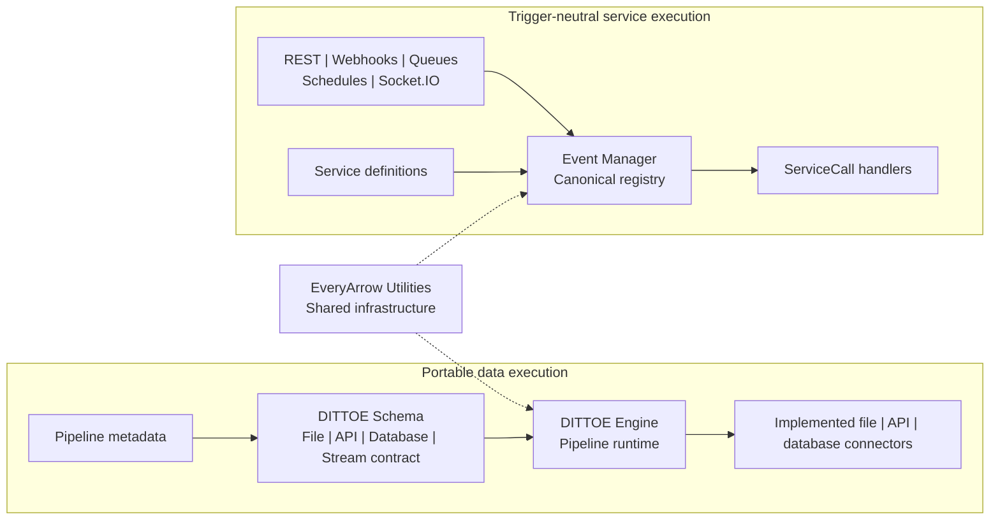

<p align="center">
  
</p>

<h1 align="center">EveryArrow</h1>

<p align="center">
  <strong>Define the system once. Move data and invoke services through reusable execution primitives.</strong>
</p>

<p align="center">
  <a href="https://github.com/EveryArrow/everyarrow/actions/workflows/ci.yml"></a>
  
  
</p>

<p align="center">
  <a href="https://everyarrow.io">Website</a>
  &nbsp;&bull;&nbsp;
  <a href="#start-here">Start here</a>
  &nbsp;&bull;&nbsp;
  <a href="CONTRIBUTING.md">Contributing</a>
  &nbsp;&bull;&nbsp;
  <a href="SECURITY.md">Security</a>
</p>

EveryArrow is the source foundation of a metadata-driven software factory. It
combines a portable data-integration language, a pipeline runtime, and a
trigger-neutral service runtime in one repository.

Use the parts independently or together:

- **DITTOE Schema** defines a portable Pipeline Metadata Document (PMD).
- **DITTOE Engine** executes that metadata through its implemented file, API,
  and database connectors.
- **Event Manager** turns REST, webhooks, queues, schedules, Socket.IO events, and
  internal calls into one `ServiceCall` execution model. PostgreSQL
  notifications are supported as an additional internal adapter.
- **Utilities** provides the shared infrastructure used by the public runtimes.

The standalone runtimes do not require an EveryArrow database, AWS account, or
hosted control plane. The complete EveryArrow platform will be distributed
separately as one Docker installation.

## How it fits together



The data and event lanes are independently usable. An application can adopt
DITTOE for portable pipelines, Event Manager for one-service-many-triggers, or
embed both. This repository does not automatically wire a DITTOE pipeline into
an Event Manager service; that composition belongs to the application or
platform plugin.

## Start here

| Your goal | Start with |
| --- | --- |
| Understand or generate portable pipeline metadata | [DITTOE Schema](dittoe-schema/README.md) |
| Execute a pipeline locally or embed the runtime | [DITTOE Engine](dittoe-engine/README.md) |
| Expose the same service logic through multiple triggers | [Event Manager](event-manager/README.md) |
| Reuse common configuration, database, HTTP, messaging, or security helpers | [EveryArrow Utilities](utilities/README.md) |

### Build the complete repository

Requirements:

- Java 21
- Maven 3.9+, or the included Maven wrapper

Windows:

```powershell
.\mvnw.cmd --batch-mode clean verify
```

macOS or Linux:

```bash
./mvnw --batch-mode clean verify
```

The root Maven reactor builds the modules in dependency order, runs the full
test suite, and packages the artifacts. The GitHub build then rejects failed,
errored, or skipped tests and verifies the DITTOE shaded JAR plus its
separately packaged MySQL-compatible driver, source archive, and license notice.

### Run Event Manager locally

Event Manager can build its registry from annotations, plugin metadata, and a
local JSON snapshot without opening a database connection.

```powershell
$env:EA_EVENT_MANAGER_MODE = "local"
.\mvnw.cmd -pl event-manager -am package
java -jar event-manager\target\event-engine-1.0.jar
```

See [database and local operating modes](event-manager/README.md#database-and-local-operating-modes)
for registry snapshot behavior, readiness, and deployment configuration.

### Run a DITTOE pipeline

DITTOE reads a PMD from `<BASE_DIR>/<pipeline-name>/pmd.json`. Once the reactor
is packaged, run a pipeline by name:

```powershell
$env:BASE_DIR = "C:\path\to\pipelines"
java -jar dittoe-engine\target\execution-1.0-shaded.jar -p my-pipeline
```

The PMD owns its source, target, mappings, and behaviors. Local file and SQLite
pipelines require no EveryArrow services; concrete connectors initialize from
the source and target selected by the PMD. The schema defines a Stream family,
but this release does not ship a concrete stream connector.

## Repository map

| Path | Responsibility | License |
| --- | --- | --- |
| [`dittoe-schema/`](dittoe-schema/) | Runtime-independent DITTOE grammar, PMD model, and language SDKs | Apache 2.0 |
| [`dittoe-engine/`](dittoe-engine/) | Pipeline execution, behaviors, formats, and connectors | BSL 1.1 |
| [`event-manager/`](event-manager/) | Service registry, transport adapters, scheduling, hooks, and plugins | BSL 1.1 |
| [`utilities/`](utilities/) | Reusable Java infrastructure and optional integration helpers | Apache 2.0 |

Module boundaries are intentional: schema code stays runtime-independent,
transport code stays outside service handlers, and shared utilities stay free
of product-specific behavior.

## Source and complete platform

EveryArrow has two distribution surfaces with different jobs:

**Complete platform through Docker.** A later, separately licensed commercial
release will deliver the full EveryArrow product through Docker and executable
artifacts. It is planned to include DITTOE, Event Manager, Swarm, Console and
UI, authentication, Security, Perch, platform databases, scheduling, and the
supporting services needed to run them together. Those artifacts are not part
of this source release.

**Independent source foundation.** This repository contains the components that
can be built, tested, embedded, and run without the complete platform. It does
not publish the Console, Swarm, Security, Perch, identity-provider
implementations, or internal deployment tooling. In this source repository:

- DITTOE Engine can execute directly from PMD configuration.
- Event Manager `local` mode uses local discovery and registry snapshots.
- Protected Event Manager calls fail closed when no Security provider is
  installed.
- Cloud helpers are optional and are not startup prerequisites.

This is the public EveryArrow source repository. Private platform components
and commercial distributions remain outside this repository and follow their
own release and licensing processes.

## Documentation

Versioned technical documentation lives beside the code:

- [DITTOE language and PMD model](dittoe-schema/README.md)
- [DITTOE execution and connector readiness](dittoe-engine/README.md)
- [Event Manager registry, transports, and plugin contract](event-manager/README.md)
- [Platform plugin packaging](event-manager/docs/platform-plugins.md)
- [Connector implementation checklist](dittoe-engine/docs/connector-implementation-checklist.md)

The documentation on the branch being built is authoritative for that version.

## Release and security

Every push to `dev` or `main` is built on a clean Java 21 environment. The
repository gate runs the complete reactor, checks every test report for skips or
failures, and verifies the DITTOE engine and separately licensed driver package.

Runtime secrets should come from process/container environment or an
operator-controlled secret store. PMDs can contain connector properties, so do
not commit credentials, private endpoints, or local environment files. Treat
PMDs and plugin JARs as trusted operator-controlled inputs.

Read [SECURITY.md](SECURITY.md) for deployment boundaries and private
vulnerability reporting.

## Contributing

Read [CONTRIBUTING.md](CONTRIBUTING.md) before proposing a change. Keep behavior
in the module that owns it, add focused tests, and run the complete root build
before opening a pull request.

## Licensing

EveryArrow uses an explicit license map. DITTOE Schema and Utilities remain
licensed under Apache 2.0. DITTOE Engine, Event Manager, and first-party
repository-level material are source-available under Business Source License
1.1 (`BUSL-1.1`).

There is no Additional Use Grant. Before the Change Date, the BSL permits
non-production use, and all production use requires a separate written
commercial license from EveryArrow LLC.

See the root [LICENSE](LICENSE), [LICENSES.md](LICENSES.md), and each
directory-level `LICENSE` before using or redistributing the software. The
planned Docker platform and executable distribution will have separate
commercial terms in a later release.
